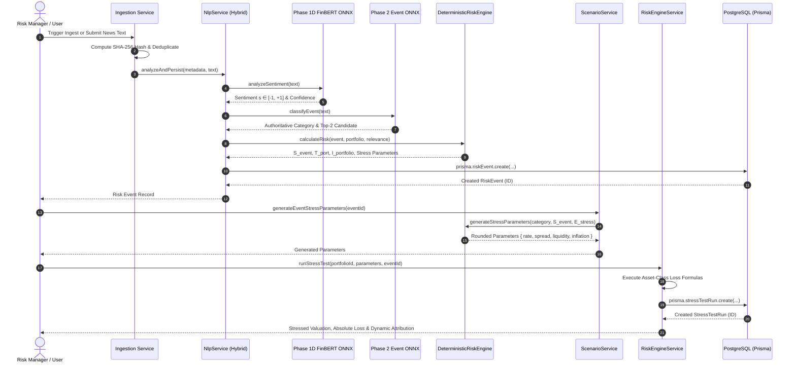

# VANTAGE System Architecture & Technical Specification

> **Deep-dive architectural specification detailing VANTAGE's multi-source ingestion pipeline, local ONNX NLP processing, and deterministic quantitative risk engine.**

---

## 📌 Architecture Design Principles

VANTAGE is architected around four core design principles:

1. **Separation of AI & Quantitative Calculations**: Language models extract semantic features (event taxonomy, sentiment, entities, explanations). Mathematical engines execute deterministic calculations (severity, portfolio exposure, impact scores, stress parameter shocks, and financial loss attribution).
2. **Local Inference Autonomy**: Key NLP models (Phase 1D FinBERT for sentiment and Phase 2 ONNX for event taxonomy) run locally via WebAssembly / ONNX Runtime. Cloud LLMs (such as Google Gemini) are optional semantic enrichment providers.
3. **Portfolio-Aware Relevance Filtering**: Market events are evaluated directly against portfolio holdings (`AAPL`, `MSFT`, `GOOGL`, `JPM`, corporate loans, bonds, derivatives) to prevent alerting managers to irrelevant news.
4. **Inspectable & Traceable Attribution**: Every financial loss calculation can be traced back to exact mathematical duration, credit spread, or liquidity haircut shift formulas.

---

## 🏗 End-to-End Component Sequence Diagram

---

## 📐 Mathematical Pipeline & Formula Reference

### 1. Sentiment Adjustment & Event Severity ($S_{\text{event}}$)
Given continuous FinBERT sentiment $s \in [-1.0, +1.0]$, sentiment multiplier $M_{\text{sent}}(s)$ is:
$$M_{\text{sent}}(s) = 1.0 - 0.35s$$

Base category severity $S_{\text{cat}}$ values:
- `Monetary policy`: 8.5
- `Credit`: 8.0
- `Macroeconomic`: 7.5
- `Commodities`: 7.0
- `Geopolitical`: 7.0
- `Sector outlook`: 6.0
- `Earnings`: 5.5
- `Regulatory`: 5.0

Event Severity $S_{\text{event}}$:
$$S_{\text{event}} = \max\left(1.0, \min\left(10.0, S_{\text{cat}} \times M_{\text{sent}}(s)\right)\right)$$

---

### 2. Portfolio Transmission Sensitivity ($T_{\text{port}}$)
Asset class exposure weights $w_A = \frac{\text{exposure}_A}{\text{baselineValue}}$ for $A \in \{\text{LOANS, BONDS, DERIVATIVES, EQUITY}\}$.

Transmission sensitivity:
$$T_{\text{port}} = \sum_{A} \left(w_A \times W_{\text{cat}, A}\right)$$

Where Category Transmission Matrix $W_{\text{cat}, A}$ defines asset sensitivity:
- `Monetary policy`: Loans 0.70, Bonds 1.00, Derivatives 0.60, Equity 0.40
- `Credit`: Loans 0.85, Bonds 0.90, Derivatives 0.50, Equity 0.30
- `Macroeconomic`: Loans 0.60, Bonds 0.70, Derivatives 0.55, Equity 0.65
- `Commodities`: Loans 0.30, Bonds 0.40, Derivatives 0.85, Equity 0.60
- `Geopolitical`: Loans 0.40, Bonds 0.50, Derivatives 0.75, Equity 0.70
- `Sector outlook`: Loans 0.30, Bonds 0.30, Derivatives 0.60, Equity 0.85
- `Earnings`: Loans 0.10, Bonds 0.20, Derivatives 0.40, Equity 1.00
- `Regulatory`: Loans 0.40, Bonds 0.30, Derivatives 0.50, Equity 0.60

---

### 3. Effective Exposure ($E_{\text{effective}}$) & Concentration ($C_{\text{conc}}$)
- `DIRECT`: $E_{\text{effective}} = E_{\text{direct}}$, $C_{\text{conc}} = 1.0 + 0.5 w_{\text{maxMatched}}^2$
- `INDIRECT`: $E_{\text{effective}} = E_{\text{indirect}}$, $C_{\text{conc}} = 1.0 + 0.5 w_{\text{maxMatched}}^2$
- `PORTFOLIO_WIDE`: $E_{\text{effective}} = 1.0$, $C_{\text{conc}} = 1.0 + 0.25 w_{\text{maxClass}}^2$
- `IRRELEVANT`: $E_{\text{effective}} = 0.0$, $C_{\text{conc}} = 1.0$

$$1.0 \le C_{\text{conc}} \le 1.5$$

---

### 4. Portfolio Impact Score ($I_{\text{portfolio}}$)
$$V_{\text{port}} = E_{\text{effective}} \times T_{\text{port}} \times C_{\text{conc}} \times H_{\text{mult}} \times R_{\text{mult}}$$
$$I_{\text{raw}} = 1.0 + (S_{\text{event}} - 1.0) \times V_{\text{port}}$$
$$I_{\text{portfolio}} = \max\left(1.0, \min\left(10.0, \text{round}(I_{\text{raw}}, 2)\right)\right)$$

---

### 5. Stress Parameter Generation
$$\text{severityScale} = \frac{S_{\text{event}}}{10.0}$$
$$E_{\text{stress}} = E_{\text{effective}} \times T_{\text{port}} \times R_{\text{stress}}$$
$$\text{rate} = \text{round}\left(\text{BaseRate} \times \text{severityScale} \times E_{\text{stress}} \times H_{\text{mult}}\right)$$
$$\text{spread} = \text{round}\left(\text{BaseSpread} \times \text{severityScale} \times E_{\text{stress}} \times H_{\text{mult}}\right)$$
$$\text{liquidity} = \text{round}\left(\text{BaseLiquidity} \times \text{severityScale} \times E_{\text{stress}} \times H_{\text{mult}}\right)$$
$$\text{inflation} = \text{round}\left(\text{BaseInflation} \times \text{severityScale} \times E_{\text{stress}} \times H_{\text{mult}}\right)$$

---

### 6. Quantitative Loss Formulas (`RiskEngineService`)
Given decimal shifts ($\text{rateShift} = \text{rate}/100$, $\text{spreadShift} = \text{spread}/100$, $\text{liquidityHaircut} = \text{liquidity}/100$, $\text{inflationShift} = \text{inflation}/100$):

$$\text{loansLoss} = \text{loansExposure} \times \left(0.4 \times \text{spreadShift} + 0.1 \times \text{rateShift}\right)$$
$$\text{bondsLoss} = \text{bondsExposure} \times \left(0.5 \times \text{rateShift} + 0.2 \times \text{spreadShift}\right)$$
$$\text{derivativesLoss} = \text{derivativesExposure} \times \left(0.6 \times \text{liquidityHaircut} + 0.2 \times \text{rateShift}\right)$$
$$\text{equityLoss} = \text{equityExposure} \times \left(0.2 \times \text{rateShift} + 0.3 \times \text{inflationShift} + 0.1 \times \text{liquidityHaircut}\right)$$

$$\text{totalLoss} = \max\left(0, \text{loansLoss} + \text{bondsLoss} + \text{derivativesLoss} + \text{equityLoss}\right)$$
$$\text{stressedValue} = \max\left(0, \text{baselineValue} - \text{totalLoss}\right)$$
$$\text{riskScore} = \min\left(100, \text{round}\left(\frac{\text{totalLoss}}{\text{baselineValue}} \times 100 \times 5\right)\right)$$

---

